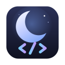
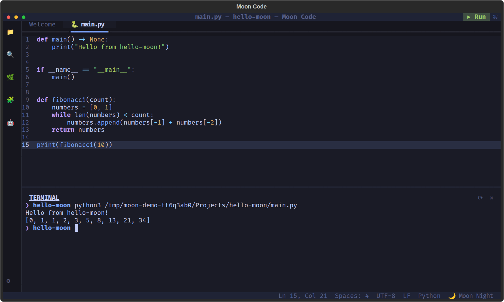

<p align="center">
  
</p>

<h1 align="center">Moon Code</h1>

<p align="center"><b>The code editor that lives in your terminal.</b><br>
Explorer, tabs, autocomplete, an integrated terminal, one-key run for 50+ languages, extensions and local AI.</p>

<p align="center">
  <a href="https://moon-technologiesco.github.io/moon-code/">Website</a> ·
  <a href="https://github.com/Moon-TechnologiesCO/moon-code/releases">Releases</a> ·
  <a href="#install">Install</a> ·
  <a href="#español">Español</a>
</p>



## Install

**Automatic (Ubuntu, Debian, macOS):**

```bash
curl -fsSL https://moon-technologiesco.github.io/moon-code/install | bash
```

On Ubuntu/Debian it installs the `.deb` with apt. On macOS it installs into `~/.moon-code`, adds the `moon` command and creates **Moon Code.app** in `~/Applications`.

**Manual:**

| System | How |
|---|---|
| Ubuntu / Debian | Download `moon-code_<version>_amd64.deb` from [Releases](https://github.com/Moon-TechnologiesCO/moon-code/releases), then `sudo apt install ./moon-code_<version>_amd64.deb` |
| macOS | Needs Python 3.10+ (`brew install python`), then run the automatic installer above |
| Anywhere with Python 3.10+ | `pip install "git+https://github.com/Moon-TechnologiesCO/moon-code.git"` |

Open it from your apps menu, or from a terminal:

```bash
moon                 # start screen
moon .               # open the current folder
moon app.py          # open a file
moon new my-app -t python   # create a project (python, node, web, csharp, empty)
moon update          # install the latest version
```

Uninstall: `curl -fsSL https://moon-technologiesco.github.io/moon-code/install | bash -s -- --uninstall`

## Features

- **Workbench like VS Code**: activity bar, explorer with icons, tabs with unsaved markers, status bar, zen mode.
- **Editing**: syntax highlighting, autocomplete, auto-indent, bracket pairs, find & replace, go to line, toggle comments, undo/redo.
- **Integrated terminal**: a real shell (`ctrl+j`) with colors and scrollback.
- **Run anything**: `F5` runs the active file, `ctrl+F5` the project (npm, Cargo, Go, .NET, Gradle, Maven, Make, Swift, Zig…).
- **Search & Git**: project-wide search (uses ripgrep when installed), branch and changed files.
- **Moon AI**: chat with local models through [Ollama](https://ollama.com); optionally include the active file. Nothing leaves your machine.
- **Extensions**: built-ins toggle in one click; write your own in one Python file.
- **Themes**: Moon Night, Moon Midnight, Moon Light.

## Keyboard shortcuts

Standard Linux shortcuts, the same as VS Code. On macOS they also use `ctrl`, so they work in every terminal.

| Action | Keys |
|---|---|
| Command palette | `F1` |
| Quick open | `ctrl+p` |
| New file / open folder | `ctrl+n` / `ctrl+o` |
| Save / close tab | `ctrl+s` / `ctrl+w` |
| Find / replace / go to line | `ctrl+f` / `ctrl+h` / `ctrl+g` |
| Toggle comment | `ctrl+/` |
| Sidebar / terminal / Moon AI | `ctrl+b` / `ctrl+j` / `ctrl+l` |
| Run file / project | `F5` / `ctrl+F5` |
| Zen mode | `F11` |

When the terminal has focus, shell keys like `ctrl+w`, `ctrl+e` and `ctrl+l` go to the shell.

## Extensions

Create one from the Extensions view (＋), or drop a file in `~/.config/moon-code/extensions/` (macOS: `~/Library/Application Support/moon-code/extensions/`):

```python
NAME = "Hello"
DESCRIPTION = "Greets the active file"

def activate(api):
    api.add_command("Hello: Greet", "Say hi", lambda: api.notify(f"Hello, {api.active_file().name}!"))
    api.add_command("Hello: Run tests", "pytest", lambda: api.run_in_terminal("pytest -q"))
```

The `api` offers `add_command`, `notify`, `run_in_terminal`, `open_file`, `active_file`, `save_active`, `reload_file` and `project_root`.

## Settings

`F1 → Preferences: Open Settings (JSON)`. Saved changes apply right away.

## Development

```bash
python3 -m venv .venv && .venv/bin/pip install -e ".[dev]"
.venv/bin/pytest -q
.venv/bin/python -m moon .
```

| Path | What |
|---|---|
| `moon/core` | Settings, languages, projects, search, git, themes, updater (no UI) |
| `moon/services` | Ollama client and the pseudo-terminal session |
| `moon/extensions` | Extension API and built-in extensions |
| `moon/ui` | Textual app, screens, widgets, dialogs and styles |
| `packaging/` | Icons, `.deb` build script and desktop entry |
| `scripts/` | Icon generator and the demo video recorder |
| `docs/` | Website (GitHub Pages) |

Releases: bump `version` in `pyproject.toml` and `moon/__init__.py`, then push a tag `vX.Y.Z`. The release workflow builds the `.deb` and attaches it.

---

## Español

Moon Code es un editor de código para la terminal, al estilo de VS Code. Su interfaz está en inglés; la [web](https://moon-technologiesco.github.io/moon-code/?lang=es) tiene versión en español.

Instalación automática (Ubuntu, Debian y macOS):

```bash
curl -fsSL https://moon-technologiesco.github.io/moon-code/install | bash
```

Luego ábrelo desde el menú de aplicaciones o con `moon .`. Para actualizar: `moon update`.

MIT © Moon Technologies
